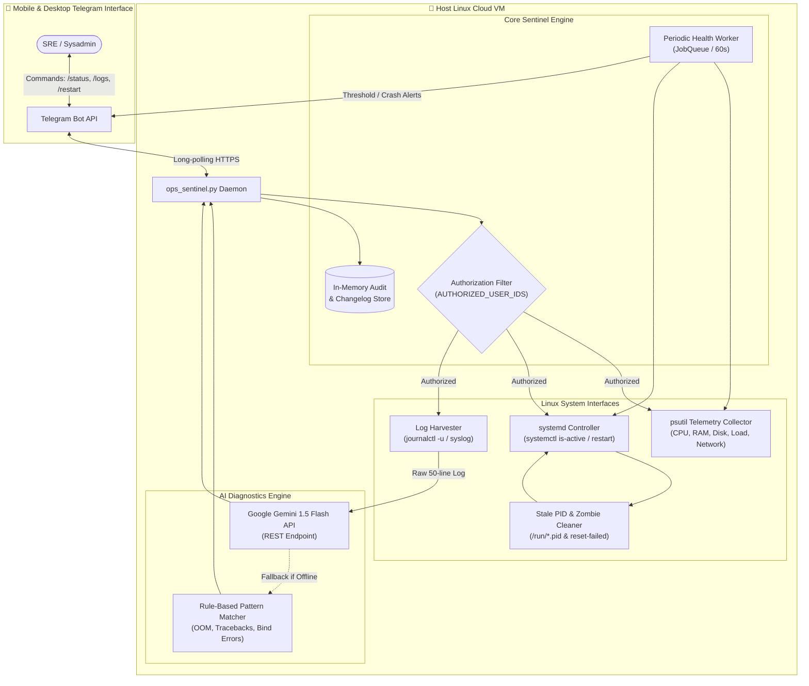

<div align="center">

# 🛡️ Telegram & Linux AI Ops Sentinel

**Autonomous 24/7 Linux Server Monitoring, AI-Powered Log Diagnostics & Self-Healing Service Recovery via Telegram**

[](https://www.python.org/)
[](https://opensource.org/licenses/MIT)
[](https://core.telegram.org/bots)
[](https://systemd.io/)
[](https://aistudio.google.com/)
[]()

*A production-grade Python operations bot that bridges Linux systems administration, LLM root-cause intelligence, and instant mobile incident remediation.*

</div>

---

## 📌 Executive Summary & Purpose

Managing remote cloud servers and background daemon processes often requires constantly opening SSH sessions, running manual `journalctl` grep filters, and debugging crashed daemons in the terminal.

**Telegram & Linux AI Ops Sentinel** was engineered to solve this operational friction. It provides DevOps engineers, bot developers, and sysadmins an automated, mobile-first command center directly inside Telegram. It continuously monitors system telemetry, detects service failures, analyzes crash logs using **Google Gemini AI**, and executes safe restarts with **stale PID lock and zombie process recovery**.

---

## 🏛️ System Architecture



---

## 🚀 Key Features

* **🖥️ Real-Time Telemetry Dashboard (`/status`):**
  * Instant retrieval of CPU percentage, per-core metrics, and Linux load averages (`1m`, `5m`, `15m`).
  * Total, used, free RAM and Swap space.
  * Root disk partition space usage and warning thresholds.
  * Network I/O throughput (Megabytes transmitted and received).
  * Top resource-consuming processes by memory and CPU.
  * Live status overview of all configured background services.

* **🔍 AI-Powered Root-Cause Log Analysis (`/logs [service]`):**
  * Reads the trailing 50 lines from `journalctl -u <service> --no-pager` or `/var/log/syslog`.
  * Passes the raw logs to **Google Gemini 1.5 Flash** for instant operational triage.
  * Outputs **Incident Severity**, **Root Cause (what broke)**, and **Recommended Remediation Commands**.
  * Includes a built-in **Heuristic Fallback Engine** that detects Out-Of-Memory (OOM) kills, Python tracebacks, port binding conflicts (`Errno 98`), broken pipes, and permission errors even without an internet connection or Gemini API key.

* **⚡ Safe Service Restart & Zombie Recovery (`/restart <service>`):**
  * Protected by a strict service **whitelist** (`ALLOWED_SERVICES`) to prevent arbitrary command execution.
  * Inspects `/run/<service>.pid` and `/var/run/<service>.pid` for dead PIDs.
  * Cleans up stale PID lock files and executes `systemctl reset-failed` to unblock systemd.
  * Verifies post-restart health and confirms that the service transitioned to `active`.

* **⏰ Scheduled Background Health Checks:**
  * Uses `python-telegram-bot`'s asynchronous `JobQueue` running at configurable intervals (default: 60s).
  * Continuously evaluates CPU, RAM, and Disk metrics against threshold limits (e.g. `> 90%`).
  * Dispatches proactive alert messages to authorized Telegram admin IDs with cooldown debouncing to avoid notification spam.
  * Optional **Auto-Healing Mode** (`AUTO_RESTART_ON_FAILURE=true`) to revive failed services autonomously.

* **🔒 Security & Role-Based Authorization:**
  * Strict `AUTHORIZED_USER_IDS` whitelist decorator (`@check_auth`).
  * Unauthenticated users cannot trigger server reboots or inspect logs.
  * All access attempts and administrative operations are recorded in an in-memory audit changelog (`/changelog`).

* **💻 Cross-Platform Developer Friendliness:**
  * Built for Linux production servers, but includes an automatic **Non-Linux Simulation Mode** so developers can write and test bot features on Windows or macOS without crashes.

---

## 🛠️ The Real-World Problem Solved: Stale PID Locks & Zombie Crashes

### The Problem
In production Linux environments, background Python scripts and bot daemons occasionally encounter unhandled segmentation faults, hard SIGKILL signals, or Out-Of-Memory (OOM) terminations. When a process terminates abruptly:
1. Its PID file (e.g., `/run/mybot.pid`) remains on disk referencing a PID that no longer exists.
2. When `systemctl restart` is executed, systemd or the daemon's internal startup wrapper checks the PID file, falsely assumes another instance is already running, and aborts with `Job for mybot.service failed because a fatal error was returned`.
3. Systemd enters a `failed (Result: exit-code)` state that requires manual operator intervention (`systemctl reset-failed`).

### The Sentinel Solution
When `/restart <service>` is invoked, **Ops Sentinel**:
1. Checks the service's state via `systemctl is-active`.
2. Inspects designated PID file locations (`/run/<service>.pid`, `/var/run/<service>.pid`).
3. Verifies if the PID recorded inside the file is alive using `psutil.pid_exists(pid)` or `/proc/<pid>`.
4. If the process is dead, the stale lock file is automatically unlinked.
5. Executes `systemctl reset-failed <service>` to clear systemd's latch counters.
6. Fires `systemctl restart <service>` and polls for 3 seconds to guarantee successful resurrection.

---

## 📋 Telegram Command Reference

| Command | Arguments | Permission | Description |
| :--- | :--- | :--- | :--- |
| `/start` | None | Public | Welcome banner, system identification, and user authorization badge. |
| `/help` | None | Public | Comprehensive operations manual and usage syntax. |
| `/status` | None | Admin | Real-time telemetry dashboard (CPU, RAM, Disk, Uptime, Top Processes). |
| `/logs` | `[service]` | Admin | Fetches 50 lines from system/service journal and runs Gemini AI root-cause analysis. |
| `/restart` | `<service>` | Admin | Safely restarts service with stale PID lock cleanup and post-restart verification. |
| `/services`| None | Admin | Displays real-time status (`active`, `inactive`, `failed`) for all monitored services. |
| `/changelog`| None | Admin | Displays chronological audit trail of all manual and automated actions during session. |

---

## 📦 Installation & Setup

### 1. Prerequisites
* **Operating System:** Linux (Ubuntu 20.04+, Debian 11+, Rocky Linux, or Amazon Linux)
* **Python:** Version 3.10 or higher
* **Telegram Bot Token:** Obtained from [@BotFather](https://t.me/BotFather)
* **Google Gemini API Key (Optional):** Free tier from [Google AI Studio](https://aistudio.google.com/)

### 2. Clone the Repository
```bash
git clone https://github.com/kunaltaydetayde7552-ship-it/telegram-linux-ops-sentinel.git
cd telegram-linux-ops-sentinel
```

### 3. Create a Virtual Environment
```bash
python3 -m venv venv
source venv/bin/activate
```

### 4. Install Dependencies
```bash
pip install --upgrade pip
pip install -r requirements.txt
```

### 5. Configure Environment Variables
Copy the template configuration file:
```bash
cp .env.example .env
nano .env
```

Populate your `.env` values:
```ini
TELEGRAM_BOT_TOKEN=123456789:ABCdefGHIjklMNOpqrsTUVwxyz
AUTHORIZED_USER_IDS=123456789
GEMINI_API_KEY=AIzaSyD-YourGeminiApiKeyHere
GEMINI_MODEL=gemini-1.5-flash
MONITORED_SERVICES=ops-sentinel,nginx,redis,postgresql
ALLOWED_SERVICES=ops-sentinel,nginx,redis,postgresql,docker,ssh
HEALTH_CHECK_INTERVAL_SEC=60
CPU_ALERT_THRESHOLD=90.0
RAM_ALERT_THRESHOLD=88.0
DISK_ALERT_THRESHOLD=92.0
AUTO_RESTART_ON_FAILURE=false
LOG_LEVEL=INFO
```

> **Tip:** To obtain your numeric Telegram User ID, send `/start` to [@userinfobot](https://t.me/userinfobot) on Telegram.

### 6. Verify Configuration
Validate your configuration and libraries without starting the bot:
```bash
python ops_sentinel.py --check-config
```

Run a quick local CLI telemetry diagnostic:
```bash
python ops_sentinel.py --cli
```

---

## ⚙️ Running 24/7 as a Linux Systemd Service

To ensure the Sentinel runs continuously in the background and automatically restarts on system reboot or unexpected crashes, install it as a systemd service.

### 1. Create the Service Unit File
Create `/etc/systemd/system/ops-sentinel.service`:
```ini
[Unit]
Description=Telegram & Linux AI Ops Sentinel Daemon
After=network.target network-online.target
Wants=network-online.target

[Service]
Type=simple
User=root
WorkingDirectory=/opt/telegram-linux-ops-sentinel
ExecStart=/opt/telegram-linux-ops-sentinel/venv/bin/python ops_sentinel.py
Restart=always
RestartSec=5
StandardOutput=journal
StandardError=journal
SyslogIdentifier=ops-sentinel
EnvironmentFile=/opt/telegram-linux-ops-sentinel/.env

# Security sandbox flags
NoNewPrivileges=false
ProtectSystem=full
ProtectHome=read-only

[Install]
WantedBy=multi-user.target
```

*(Note: If running as a non-root user, ensure the user has passwordless sudo rights in `/etc/sudoers` for `systemctl restart` and `journalctl`).*

### 2. Enable and Start the Service
```bash
sudo systemctl daemon-reload
sudo systemctl enable ops-sentinel
sudo systemctl start ops-sentinel
```

### 3. Verify Service Health
```bash
sudo systemctl status ops-sentinel
```

### 4. Inspect Live Logs
```bash
sudo journalctl -u ops-sentinel -f -n 50
```

---

## 🧪 Testing & Failure Simulation

To verify that the Sentinel properly detects crashes, cleans stale locks, and alerts via Telegram:

1. **Simulate a Process Crash:**
   ```bash
   bash simulate_crash.sh
   ```
   *(This helper script simulates a sudden process crash, creates a stale PID lock file, and tests recovery).*

2. **Trigger Telegram Commands:**
   * Run `/status` in your Telegram chat to inspect live server metrics.
   * Run `/logs ops-sentinel` to see Gemini AI analyze recent startup logs.
   * Run `/restart nginx` to observe the step-by-step lock checking and restart trace.
   * Run `/changelog` to review the audit trail.

---

## 🔐 Security & Hardening Best Practices

1. **Telegram User Authorization:** Never run the Sentinel with an empty `AUTHORIZED_USER_IDS` in a public production environment. The `@check_auth` decorator blocks unlisted users from executing operational commands.
2. **Whitelist Restarts:** Only services explicitly named in `ALLOWED_SERVICES` can be restarted via Telegram. Arbitrary command execution is impossible.
3. **Environment Secrets:** Never commit `.env` to Git. The provided `.gitignore` automatically prevents `.env` and sensitive log files from being staged.

---

## 📄 License & Author

* **Author:** [Kunal Tayde](https://github.com/kunaltaydetayde7552-ship-it)
* **Email:** [kunaltaydetayde7552@gmail.com](mailto:kunaltaydetayde7552@gmail.com)
* **Repository:** [https://github.com/kunaltaydetayde7552-ship-it/telegram-linux-ops-sentinel](https://github.com/kunaltaydetayde7552-ship-it/telegram-linux-ops-sentinel)
* **Project:** Telegram & Linux AI Ops Sentinel
* **License:** [MIT License](LICENSE)
